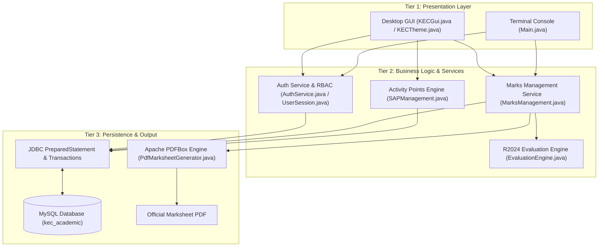

# KEC ACADEMIX — Student Academic Evaluation & Management System

> **Institutional Academic Evaluation & Continuous Assessment Platform**  
> **Kongu Engineering College (Autonomous), Perundurai, Erode — 638060**  
> **Course:** 24ITT32 — Programming in Java Laboratory Project

---

### 👨‍🎓 Candidate & Project Details

| Parameter | Details |
| :--- | :--- |
| **Student Name** | **Vikneshwaran N** |
| **Roll Number** | **25ITR173** |
| **Degree & Branch** | B.Tech. Information Technology |
| **Regulation** | KEC Autonomous Regulations 2024 (R2024) |
| **Repository** | [github.com/VikneshwaranNv/Java_JDBC_project](https://github.com/VikneshwaranNv/Java_JDBC_project) |

---

### 📂 Quick Access: Project Documents & Walkthrough Video

Access the official laboratory record and project demonstration video directly:

| Asset | Direct Actions (One-Click) | Repository Folder |
| :--- | :--- | :--- |
| **📄 Project Manual (PDF)** | [⬇️ **Download PDF Manual**](https://github.com/VikneshwaranNv/Java_JDBC_project/raw/main/Jdbc%20manual%20document/Java_JDBC_PDF_Manual.pdf) &nbsp;•&nbsp; [👁️ View in Repository](https://github.com/VikneshwaranNv/Java_JDBC_project/tree/main/Jdbc%20manual%20document) | [`Jdbc manual document/`](Jdbc%20manual%20document/) |
| **🎬 Demonstration Video (MP4)** | [▶️ **Watch / Stream Video Directly**](https://github.com/VikneshwaranNv/Java_JDBC_project/raw/main/Java-jdbc%20explantion%20video/video-jdbc_fE9iydgH.mp4) &nbsp;•&nbsp; [⬇️ **Download Video**](https://github.com/VikneshwaranNv/Java_JDBC_project/raw/main/Java-jdbc%20explantion%20video/video-jdbc_fE9iydgH.mp4) | [`Java-jdbc explantion video/`](Java-jdbc%20explantion%20video/) |

---

## 📁 Repository Structure

```text
├── Java-Jdbc-project/             # Full application source code, libraries, SQL migrations & assets
│   ├── codes/                     # Java source files (KECGui, Main, EvaluationEngine, etc.)
│   ├── lib/                       # Dependency JARs (MySQL Connector, Apache PDFBox, jBCrypt)
│   ├── assets/                    # Official KEC crest branding
│   ├── migrations/                # Database SQL schemas
│   └── README.md                  # Local build & execution guide
├── Jdbc manual document/          # Project manual & lab record (Java_JDBC_PDF_Manual.pdf)
├── Java-jdbc explantion video/    # Video demonstration recording (video-jdbc_fE9iydgH.mp4)
├── .gitignore
└── README.md                      # Top-level documentation
```

---

## 🔌 What is JDBC (Java Database Connectivity)?

**JDBC (Java Database Connectivity)** is an industry-standard Java API (`java.sql` and `javax.sql`) providing universal, database-independent connectivity between Java applications and relational database engines (MySQL, PostgreSQL, Oracle).

### Core Components of JDBC
* **`DriverManager`:** Coordinates registered drivers and establishes live database sessions via connection URLs (`jdbc:mysql://127.0.0.1:3306/kec_academic`).
* **`Connection`:** Manages live database communication and transactional boundaries (`commit()`, `rollback()`, `setAutoCommit(false)`).
* **`PreparedStatement`:** Executes precompiled SQL queries with typed parameter binding (`?`), optimizing execution plans and completely neutralizing **SQL Injection**.
* **`ResultSet`:** A cursor-based tabular data structure that traverses query results and maps database records into Java objects.

> **Why JDBC in KEC ACADEMIX?** Guarantees zero-overhead direct SQL performance, atomic multi-table commit/rollback across marks and attendance, and deterministic schema constraint validation.

---

## 🛠️ Tech Stack & Tooling

| Component | Technology | Version | Purpose |
| :--- | :--- | :--- | :--- |
| **Language** | **Java** | OpenJDK 21 LTS | Core OOP logic, modern switch expressions, multithreading, and file I/O. |
| **Desktop GUI** | **Java Swing & AWT** | Built-in JFC | Institutional desktop interface with Midnight Navy & Cream themes. |
| **Terminal CLI** | **Java Standard I/O** | `java.util.Scanner` | Interactive console interface for headless administration and grading tests. |
| **Database** | **MySQL Server** | 8.0 Community | ACID-compliant relational storage with foreign key cascade integrity. |
| **Database API** | **JDBC** | `java.sql.*` | Parameterized persistence and transactional operations. |
| **JDBC Driver** | **MySQL Connector/J** | `26.7.0` | Type-4 pure Java network driver over port 3306. |
| **Security** | **jBCrypt** | `0.4` | Salted password hashing (work factor 12) for role-based authentication. |
| **PDF Engine** | **Apache PDFBox** | `2.0.31` | Vector graphics rendering of official institutional semester marksheets. |

---

## 🏗️ Architecture & Workflow

KEC ACADEMIX follows a **Clean 3-Tier Layered Architecture**:



### System Flow Summary
1. **Authentication:** User inputs credentials $\rightarrow$ `AuthService` verifies BCrypt salted hash against database $\rightarrow$ active `UserSession` is initialized with role-based permissions (Admin, Faculty, Student).
2. **Evaluation & Grading:** Faculty enters continuous assessment & ESE marks $\rightarrow$ `EvaluationEngine` validates attendance rules ($\ge$75% eligible, 65%–74.9% condonation, $<$65% detained), scales internal marks per course category, enforces minimum thresholds, and computes 10-point letter grades (`O` to `RA`).
3. **Marksheet Generation:** `PdfMarksheetGenerator` retrieves credit-weighted course grades, computes semester SGPA, and compiles a sealed institutional PDF with official crest vector layout via Apache PDFBox.

---

## 🚀 Quick Start (Compile & Run)

Navigate to the [`Java-Jdbc-project/`](Java-Jdbc-project/) folder:

```bash
cd Java-Jdbc-project
```

### 1. Compile Application
```bash
javac -cp "lib/*" -d build codes/*.java
```

### 2. Launch Swing Desktop GUI
```bash
java -cp "build;lib/*" KECGui
```

### 3. Launch Interactive Terminal Console (CLI)
```bash
java -cp "build;lib/*" Main
```

---

## 🔑 Demo Login Accounts

| Role | Username | Password | Responsibilities |
| :--- | :--- | :--- | :--- |
| **Administrator** | `test_admin_sys` | `AdminSecret2026!` | Course catalog setup, user management, system audit. |
| **Faculty / Staff** | `test_staff_kavitha` | `StaffSecret2026!` | CIA & ESE marks entry, condonation approval, SAP verification. |
| **Student** | `test_stud_arun` | `ValidStudentPass123!` | Roll No: `24CSE001` — View grades, upload certificates, download PDF marksheets. |

---

## 📑 Course Evaluation Models (KEC R2024 Regulations)

| Course Category | CIA Weight | ESE Weight | Minimum Passing Criteria |
| :--- | :---: | :---: | :--- |
| **Theory Courses** | **40%** | **60%** | $\ge$45% in ESE & $\ge$50% Aggregate |
| **Practical Courses** | **60%** | **40%** | $\ge$50% in ESE & $\ge$50% Aggregate |
| **Embedded Theory + Practical** | **50%** | **50%** | $\ge$45% in Theory ESE, $\ge$50% in Lab ESE & $\ge$50% Aggregate |

* **Attendance Requirements:** $\ge$75% Eligible to write ESE; 65%–74.9% requires Medical Condonation; $<$65% Detained (`SA`).
