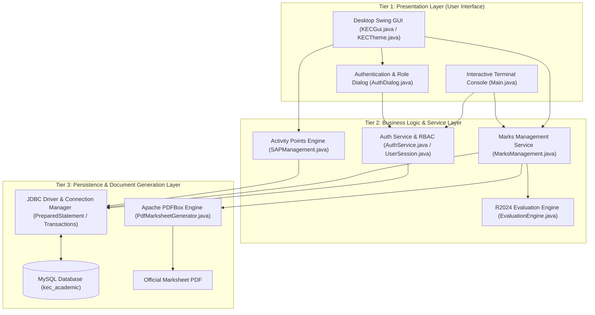
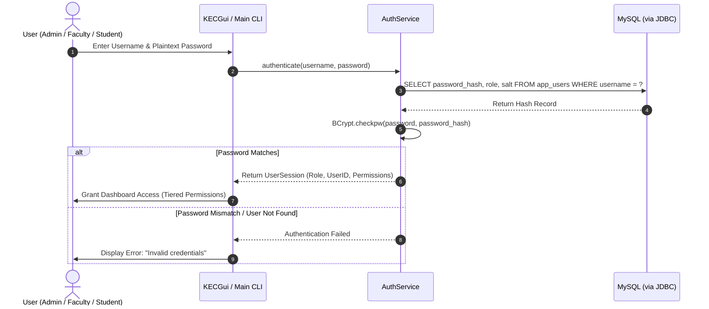
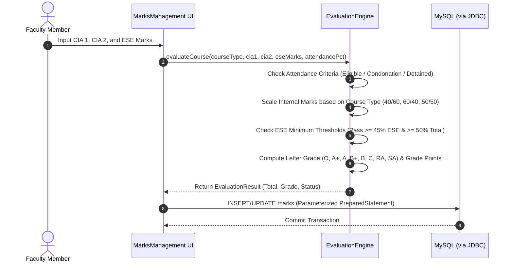

# KEC ACADEMIX — Student Academic Evaluation & Management System

> **Institutional Academic Evaluation & Continuous Assessment Platform**  
> **Kongu Engineering College (Autonomous), Perundurai, Erode — 638060**  
> **Course:** 24ITT32 — Programming in Java Laboratory Project

---

### 👨‍🎓 Candidate & Project Details

| Parameter | Details |
| :--- | :--- |
| **Student Name** | **Vikneshwaran N** |
| **Roll Number** | **25ITR173** |
| **Degree & Branch** | B.Tech. Information Technology |
| **Regulation** | KEC Autonomous Regulations 2024 (R2024) |
| **Repository** | [github.com/VikneshwaranNv/Java_JDBC_project](https://github.com/VikneshwaranNv/Java_JDBC_project) |

---

## 📁 Repository Structure

The repository is organized into three clean, dedicated modules:

| Directory | Description | Quick Links |
| :--- | :--- | :--- |
| **[`Java-Jdbc-project/`](Java-Jdbc-project/)** | Complete Java source code, dependency JARs, database migrations, assets, and project files. | [📂 Open Project Folder](Java-Jdbc-project/) |
| **[`Jdbc manual document/`](Jdbc%20manual%20document/)** | Official lab record manual, report, and project documentation (`Java_JDBC_PDF_Manual.pdf`). | [⬇️ Direct Download PDF](https://github.com/VikneshwaranNv/Java_JDBC_project/raw/main/Jdbc%20manual%20document/Java_JDBC_PDF_Manual.pdf) |
| **[`Java-jdbc explantion video/`](Java-jdbc%20explantion%20video/)** | High-definition project demonstration and walkthrough video (`video-jdbc_fE9iydgH.mp4`). | [⬇️ Direct Download Video](https://github.com/VikneshwaranNv/Java_JDBC_project/raw/main/Java-jdbc%20explantion%20video/video-jdbc_fE9iydgH.mp4) |

---

## 🔌 What is JDBC (Java Database Connectivity)?

**JDBC (Java Database Connectivity)** is an industry-standard Java API provided by the `java.sql` and `javax.sql` packages that enables Java applications to interact independently with relational database management systems (RDBMS) such as MySQL, PostgreSQL, and Oracle.

### Core Architectural Components of JDBC

```
+-------------------------------------------------------------+
|                     Java Application                        |
+-------------------------------------------------------------+
                              |
                              v
+-------------------------------------------------------------+
|                      JDBC Driver Manager                    |
+-------------------------------------------------------------+
                              |
                              v
+-------------------------------------------------------------+
|             MySQL Connector/J Driver (Type 4)               |
+-------------------------------------------------------------+
                              |  (Direct TCP/IP Socket via Port 3306)
                              v
+-------------------------------------------------------------+
|                        MySQL Database                       |
+-------------------------------------------------------------+
```

1. **`DriverManager`**: The central factory class that manages database drivers and creates active database connection sessions based on a database connection URL (e.g., `jdbc:mysql://127.0.0.1:3306/kec_academic`).
2. **`Connection`**: Represents the live socket connection with the database. It manages transactional boundaries through ACID controls (`setAutoCommit(false)`, `commit()`, and `rollback()`).
3. **`PreparedStatement`**: A precompiled SQL statement mechanism. PreparedStatement binds parameterized variables (`?`), guarantees type safety, optimizes query execution plans on the server, and **eliminates SQL Injection vulnerabilities**.
4. **`ResultSet`**: A dynamic cursor-based tabular data structure returned by query execution (`executeQuery()`), allowing row-by-row traversal and extraction of strongly-typed database records (`getInt`, `getString`, `getDouble`).

### Why JDBC in KEC ACADEMIX?
* **Deterministic Transaction Management:** Continuous assessments, marks, and attendance status must be written atomically across multiple related tables (`courses`, `marks`, `attendance`). JDBC guarantees strict rollback upon failure.
* **Zero Overhead & Full Control:** By eliminating heavy Object-Relational Mapping (ORM) abstractions, JDBC provides raw execution speed and full authority over SQL indexing, locking, and constraints.
* **Portable Driver Architecture:** Modular Type-4 pure Java driver (`mysql-connector-j-26.7.0.jar`) enables direct TCP communication with the MySQL engine without native client libraries.

---

## 🛠️ Tech Stack & Tooling

| Category | Technology / Tool | Version / Artifact | Role in KEC ACADEMIX |
| :--- | :--- | :--- | :--- |
| **Language** | **Java** | OpenJDK 21 (LTS) | Core application platform leveraging modern OOP, enhanced switch expressions, pattern matching, and robust multithreading. |
| **User Interface** | **Java Swing & AWT** | Built-in JFC | Desktop graphical interface featuring dual custom themes (KEC Midnight Navy & Institutional Cream), custom dialogs, table models, and validation listeners. |
| **CLI Console** | **Java Standard I/O** | `java.util.Scanner` | An interactive terminal console interface providing headless administration and CLI evaluation capabilities. |
| **Database** | **MySQL Server** | 8.0.x Community | Relational storage engine enforcing strict schema constraints, foreign key cascades, unique roll number constraints, and indexed course catalogs. |
| **Database API** | **JDBC** | `java.sql.*` API | Direct transactional persistence layer using `PreparedStatement` parameterization and connection pooling. |
| **JDBC Driver** | **MySQL Connector/J** | `26.7.0` | High-performance Type-4 pure Java driver translating JDBC calls directly into the MySQL binary client-server network protocol. |
| **Security API** | **jBCrypt** | `0.4` | Salted One-Way Password Hashing (Cost factor: 12) for safeguarding user credentials across Admin, Faculty, and Student accounts. |
| **PDF Generation** | **Apache PDFBox** | `2.0.31` | Low-level document engine that dynamically renders institutional semester marksheets with institutional crests, tabular marks, and verification signatures. |
| **Build & VCS** | **Git & GitHub** | 2.4x / GitHub Cloud | Version control, modular release structuring, and continuous cloud hosting of project source code, PDF reports, and demo videos. |

---

## 🏗️ Architecture & Workflow

KEC ACADEMIX implements a **Clean 3-Tier Layered Architecture** with strict separation of concerns across presentation, business evaluation logic, and relational persistence.

### High-Level Architecture Diagram



---

### Core System Workflows

#### 1. Authentication & Role-Based Access Control (RBAC) Workflow


#### 2. Academic Evaluation & R2024 Grading Workflow


#### 3. Marksheet Generation Workflow
1. The student or faculty initiates a **"Generate Marksheet"** request.
2. `PdfMarksheetGenerator` queries the student's personal details, registered courses, credit weights, and evaluated grades through JDBC.
3. The engine uses `EvaluationEngine.calculateSGPA()` to compute the credit-weighted Semester Grade Point Average and equivalent percentage.
4. Using **Apache PDFBox**, a high-resolution institutional marksheet document is synthesized in memory with official crest vector graphics, structured marks tables, pass/fail summaries, and authorized sign-off lines, saved directly to the user's filesystem.

---

## 🚀 Quick Start & Installation

To run **KEC ACADEMIX** locally on your machine:

### Prerequisites
* **Java Development Kit (JDK):** Version 21 or higher installed (`java -version` & `javac -version`).
* **MySQL Server:** Version 8.0 or higher running on `127.0.0.1:3306` with database `kec_academic`.

### Step-by-Step Execution

1. **Clone the Repository:**
   ```bash
   git clone https://github.com/VikneshwaranNv/Java_JDBC_project.git
   cd Java_JDBC_project/Java-Jdbc-project
   ```

2. **Compile the Java Application:**
   ```bash
   javac -cp "lib/*" -d build codes/*.java
   ```

3. **Launch the Swing Desktop GUI:**
   ```bash
   java -cp "build;lib/*" KECGui
   ```

4. **Launch the Interactive Terminal Console (CLI):**
   ```bash
   java -cp "build;lib/*" Main
   ```

---

## 🔑 Default Login Credentials

| Role | Username | Password | Privileges & Responsibilities |
| :--- | :--- | :--- | :--- |
| **System Administrator** | `test_admin_sys` | `AdminSecret2026!` | Course catalog setup, user management, system audit, database migrations. |
| **Faculty / Staff** | `test_staff_kavitha` | `StaffSecret2026!` | Continuous internal marks entry, ESE recording, medical condonation approval, SAP point verification. |
| **Student** | `test_stud_arun` | `ValidStudentPass123!` | Roll No: `24CSE001` — View personal grades, calculate tentative SGPA, upload SAP certificates, download official PDF marksheet. |

---

## 📑 Course Evaluation Models (KEC R2024 Regulations)

The application faithfully implements the Autonomous Regulations 2024 scoring models:

| Course Category | Continuous Internal Assessment (CIA) | End Semester Examination (ESE) | Minimum Passing Criteria |
| :--- | :---: | :---: | :--- |
| **Theory Courses** | **40%** | **60%** | $\ge$45% in ESE & $\ge$50% Aggregate |
| **Practical Courses** | **60%** | **40%** | $\ge$50% in ESE & $\ge$50% Aggregate |
| **Embedded Theory + Practical** | **50%** | **50%** | $\ge$45% in Theory ESE, $\ge$50% in Lab ESE & $\ge$50% Aggregate |

### Attendance Regulations
* **$\ge$ 75% Attendance:** Eligible to sit for End Semester Examinations.
* **65% to 74.9% Attendance:** Requires authorized Medical Condonation approval from the Head of Department.
* **$<$ 65% Attendance:** Detained due to lack of attendance (Grade `SA` / Shortage of Attendance); must re-register for the course.
